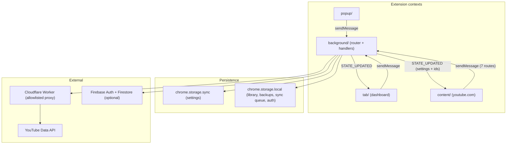

# Architecture

## Context diagram



## Source layout

```
src/
  background/
    index.js            # wiring: lifecycle, listeners, context object
    router.js           # route table dispatch, payload schemas, sender-context auth, command queue
    context.js          # commit(): transaction + save + sync queue + broadcast
    handlers/           # series, episodes, collections, settings, library, app (search/sync/tab)
    autoRefresh.js      # bounded-concurrency refresh + notifications
    backups.js, broadcast.js, demoData.js
  services/             # youtube.js (retry + circuit breaker), chrome/* wrappers, sync/* (Firebase REST)
  state/store.js        # single source of truth; transaction(), never written from outside
  shared/               # events, constants, i18n, errors, logger, resilience, schema, dom, icons, seriesValidation
  tab/                  # dashboard — see 05-tab-ui.md
  content/              # YouTube integration — see 06-content-and-popup.md
  popup/
cloudflare-worker/      # proxy (separate deploy) — see 06-infrastructure.md
scripts/                # build.mjs, smoke.mjs, lint-css.mjs
```

## Service worker lifecycle

- MV3 suspends the worker when idle; every entry point awaits `ensureInit()` (3 attempts, exponential backoff; a failed init is retried by the next event).
- `init()`: storage access level → `store.loadFromStorage()` → legacy API-key migration (synced settings → local) → alarms → `initSync()`.
- Background-initiated work (alarms, notification clicks, toolbar click) runs through `runTask()`, which logs failures instead of leaving unhandled rejections.

## Mutation flow

1. Client sends `{ type, payload }`.
2. `router.dispatch()` checks the route exists, the **sender context** may call it, and parses the payload with the route's schema (unknown keys dropped, ids validated).
3. Commands run serialized through the command queue; reads run concurrently.
4. Handlers mutate via `commit(ctx, store => …)`: the change and `saveToStorage()` run inside `store.transaction()` — a failed save rolls memory back.
5. After a durable save, `commit()` queues cloud sync for touched series (failures logged, retried by the `syncRetry` alarm) and broadcasts `STATE_UPDATED`.
6. Errors become `{ success: false, error: CODE, message }` (`toErrorResponse`); the UI maps codes to translated messages.

## Resilience

| Concern | Mechanism |
|---------|-----------|
| Transient network/API errors | `withRetry` (exponential backoff + jitter) on 429/5xx/timeouts only |
| Failing upstream | `CircuitBreaker` on the YouTube service (5 failures → 5 min fail-fast) |
| Batch refresh | `mapLimit` (concurrency 2), per-playlist isolation, one atomic commit |
| Corrupt save | `store.transaction` rollback; automatic backups before delete/import/restore/reset |
| UI render errors | `safeRender` error boundary per section with Retry; global `error`/`unhandledrejection` handlers |
| Orphaned content script | messenger detects "context invalidated" and shuts the integration down |

## Security model

- Extension pages (`chrome-extension://<id>/…`) may call every route; content scripts (youtube.com renderer) only `EPISODE_PROGRESS`, `EPISODE_WATCH`, `GET_NEXT_EPISODE`, `PLAYLIST_EXISTS`, `PLAYLIST_ADD`, `OPEN_SERIES_TAB`, `CONTENT_SETTINGS_GET`.
- Content scripts never receive the library: broadcasts carry settings + saved ids only.
- `chrome.storage` access level is `TRUSTED_CONTEXTS`.
- No HTML strings anywhere in UI code (ESLint bans `innerHTML`); `h()` only sets text nodes and scheme-checked URLs.
- CSP: `script-src 'self'`, no remote code. Worker hardening: [06-infrastructure.md](06-infrastructure.md).

## Related

- Messages: [02-message-protocol.md](02-message-protocol.md)
- Data shapes: [03-data-model.md](03-data-model.md)
